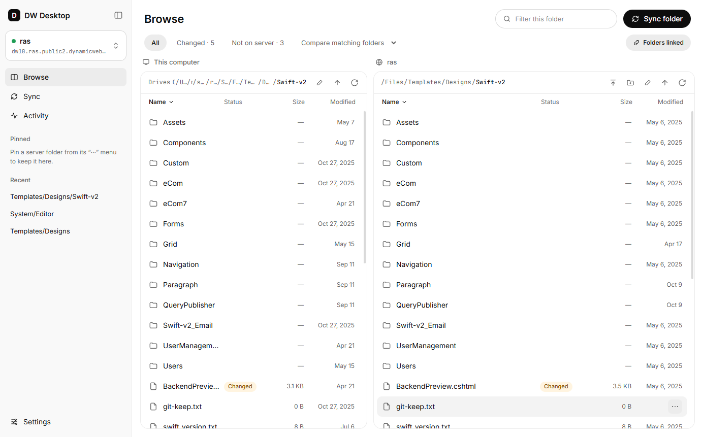
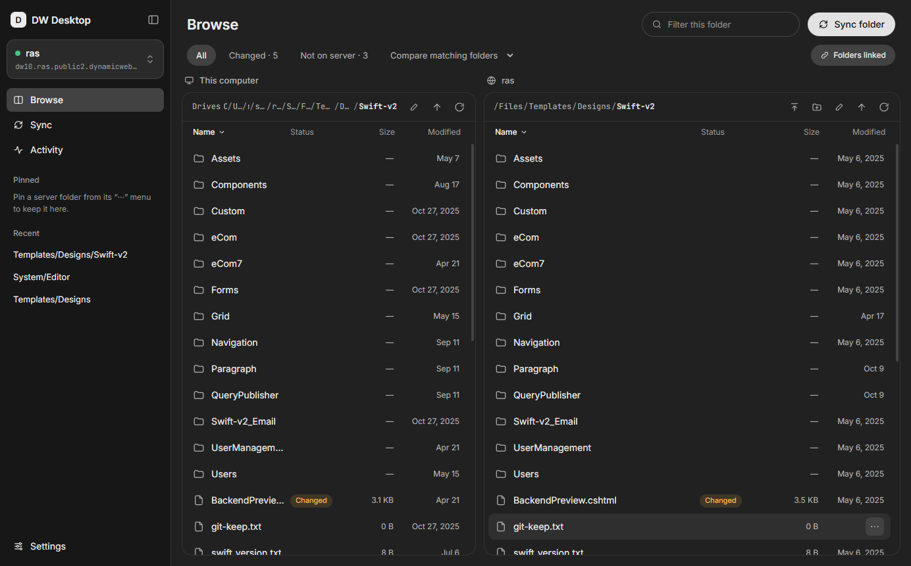

# DW Desktop

A cross-platform desktop application for moving files between your computer and [Dynamicweb 10](https://www.dynamicweb.com) solutions — browse, deploy and sync, all without needing a terminal.




---

## Download

Get the latest version from the [Releases page](https://github.com/dynamicweb/dw-desktop/releases/latest).

| Platform | Download |
|---|---|
| **Windows** (x64 — most PCs) | `dw-desktop-*-x64-setup.exe` |
| **Windows** (ARM64 — Snapdragon / Surface Pro X) | `dw-desktop-*-arm64-setup.exe` |
| **macOS** (Universal — Intel + Apple Silicon) | `dw-desktop-*.dmg` |
| **Linux** | `.AppImage` or `.deb` |

> **macOS note:** The app is not yet notarized with Apple. On first launch, right-click the app and choose **Open** to bypass the Gatekeeper warning.

---

## What you can do

- **Browse** your computer and a DW10 site side by side, and see what differs
- **Deploy** a local folder to the server, with a preview of every change first
- **Get** what is missing or newer on the server back to your computer
- Work across several environments (development, staging, production)
- Follow every transfer in **Activity**, and retry or cancel it there


## Key features

- **Browse — dual-pane file browser**  
  This computer on the left, the server on the right. Drag files between them, or onto a folder, to upload or download.

- **Compare**  
  Matching folders are compared automatically: files are marked *Changed*, *Not on server* or *Only on server*, with filters to show just those.

- **Linked folders**  
  When both panes are inside matching `/Files` folders they navigate together; arrow buttons open the matching folder on the other side.

- **Sync — deploy and get with a preview**  
  Pick a local and a server folder and a direction (**Deploy to server** or **Get from server**), then **Preview changes** before anything is written. Optionally compare file content (not just size and date) and delete files that only exist on the other side; deletes on your computer go to the recycle bin / trash.

- **Exclude rules**  
  Junk such as `.git`, `node_modules` and `.DS_Store` is never deployed. Add your own patterns per sync, share them in a `.dwignore` file, or use your `.gitignore`. Excluded files are left alone on both sides, so a sync with delete never removes them.

- **Conflict detection**  
  DW Desktop remembers what each sync wrote. If a file changed on both sides since the last sync it is flagged as a conflict and you choose which version wins — nothing is silently overwritten.

- **Saved syncs**  
  Save a sync (folders, direction and options) to run it again from the sidebar.

- **Remote file management**  
  New folder, rename, move and delete directly on the server. Pin server folders to the sidebar; recent folders are listed there too.

- **Activity**  
  Every upload, download and sync, grouped by batch, with progress. Cancel a whole batch or a single file, and retry failed ones. The history is kept for 30 days; transfers that were running when the app closed show as *Interrupted* and can be retried.

- **Reliable transfers**  
  Built on the Dynamicweb 10 File Transfer API: large files upload in chunks, downloads resume, and replaces are guarded so a file changed on the server meanwhile is not overwritten.

- **Multiple environments**  
  Switch environments from the top of the sidebar. Each environment is marked *Production*, *Staging* or *Development*, and production sites show a visible warning.

- **Flexible authentication**  
  OAuth client credentials, API key, or username/password

- **Cross-platform, light and dark**  
  Runs on Windows, macOS and Linux; light, dark or follow your OS

## Requirements

The site must run a Dynamicweb 10 version that includes the **File Transfer API** (`/Admin/Api/FileTransfer`). When you add an environment, DW Desktop tests the connection and tells you if the site doesn't expose it.


## When to use it

DW Desktop is ideal when you need to:

- Deploy files to a staging or production environment
- Pull files down for debugging or local development
- Quickly inspect or fix something directly on a remote instance
- Work across multiple environments without juggling credentials or tools

## Need a CLI instead?

If you're working in a terminal, automating deployments, or running file operations from a CI/CD pipeline, the **[DynamicWeb CLI](https://github.com/dynamicweb/CLI)** covers the same file workflows — plus queries, commands, and add-in installs — entirely from the command line.

```sh
# Upload files in a pipeline
dw files ./dist templates -i -r --output json \
  --host your-solution.example.com \
  --auth oauth \
  --clientIdEnv DW_CLIENT_ID \
  --clientSecretEnv DW_CLIENT_SECRET
```

The CLI supports OAuth client credentials for headless and CI/CD use, and returns structured JSON output that scripts can consume directly.

## Getting started

### 1. Download and install

Download the app from the [Releases page](https://github.com/dynamicweb/dw-desktop/releases/latest) and install it.

### 2. Add an environment

Open the environment switcher at the top of the sidebar and choose **Add environment** (on first launch, use **Add environment** in the server pane). Fill in:

- **Name** — a label for the environment (e.g. "My solution staging")
- **Host** — the URL of your DW10 solution (e.g. `https://mysite.example.com`)
- **Environment type** — Production, Staging or Development. Production sites get a visible warning before anything is written.
- **Local start folder** *(optional)* — a default local folder to open for this environment

Environments can be edited or removed later under **Settings** (or **Manage environments** in the switcher).

### 3. Choose an authentication method

Click **Next** to reach the Authentication step. Three methods are available:

#### OAuth (recommended for most setups)

Uses the OAuth 2.0 Client Credentials flow — no user password stored, tokens are short-lived.

**When to use:** Preferred for all interactive use. More secure than API keys and easier to revoke.

**How to set up in DW10:**
1. Go to **Settings → System → Developer → OAuth Clients**
2. Click **Add client**
3. Set **Grant type** to **Client credentials**
4. Copy the generated **Client ID** and **Client secret** into the app

> Full guide: [OAuth Clients — Dynamicweb docs](https://doc.dynamicweb.dev/manual/dynamicweb10/settings/system/developer/oauth.html)

#### API key

A static token tied to a specific DW10 user account.

**When to use:** When OAuth is not available on your solution version, or for quick testing. Less flexible than OAuth — the key stays valid until manually deleted.

**How to set up in DW10:**
1. Go to **Settings → System → Developer → API Keys**
2. Click **Add API key**
3. Assign it to a user with sufficient file permissions
4. Copy the key into the app

> Full guide: [API Keys — Dynamicweb docs](https://doc.dynamicweb.dev/manual/dynamicweb10/settings/system/developer/api-keys.html)

#### Username & password

Authenticates directly with a DW10 backend user account.

**When to use:** As a fallback when neither OAuth nor API keys are available. Not recommended for shared or long-running setups.

### 4. Browse, deploy and get

- **Browse** shows this computer and the server side by side. Open the same folder on both sides to see what differs.
- **Sync folder** (top right in Browse) opens **Sync** with the two folders you are looking at. Choose **Deploy to server** or **Get from server**, click **Preview changes**, review the list, then run it.
- Watch progress in **Activity** — or in the progress pill at the bottom right — and cancel or retry from there.


## Contributing

Contributions are welcome. The app is built with Electron + Vite + React + TypeScript.

### Prerequisites

- [Node.js](https://nodejs.org/) 18 or later
- npm (comes with Node.js)

### Clone and install

```bash
git clone https://github.com/dynamicweb/dw-desktop.git
cd dw-desktop
npm install
```

### Run in development

```bash
npm run dev
```

This starts the Electron app with hot-reload for the renderer process.

### Type checking and tests

```bash
npm run typecheck
npx vitest run
```

### Build a distributable

```bash
# Windows
npm run build:win

# macOS
npm run build:mac

# Linux
npm run build:linux
```

### Linux runtime dependencies

If the app fails to launch on Linux with a shared-library error, install the missing system packages:

**Ubuntu 24.04+**
```bash
sudo apt install -y libnspr4 libnss3 libasound2t64 libsecret-1-0
```

**Older Ubuntu / Debian**
```bash
sudo apt install -y libnspr4 libnss3 libasound2 libsecret-1-0
```

### Tech stack

| Layer | Technology |
|---|---|
| Shell | Electron |
| Bundler | electron-vite |
| UI | React 19 + TypeScript |
| Styling | Tailwind CSS v4 |
| State | Zustand |
| Credential storage | keytar |

### IDE setup

[VSCode](https://code.visualstudio.com/) with the [ESLint](https://marketplace.visualstudio.com/items?itemName=dbaeumer.vscode-eslint) and [Prettier](https://marketplace.visualstudio.com/items?itemName=esbenp.prettier-vscode) extensions is recommended.
