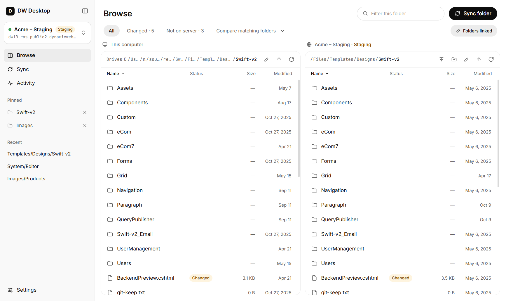
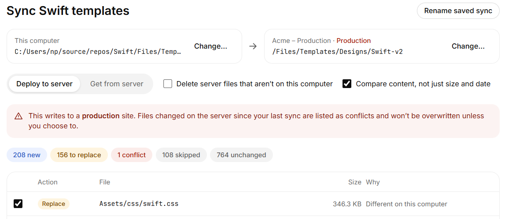
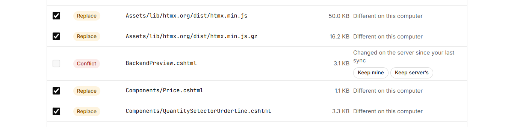
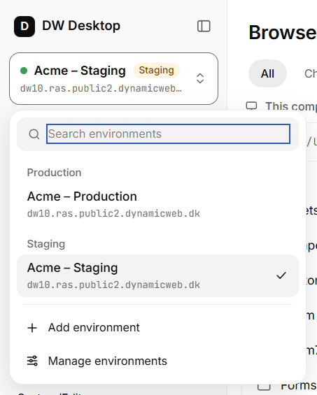
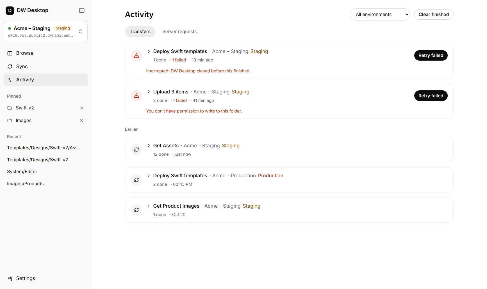
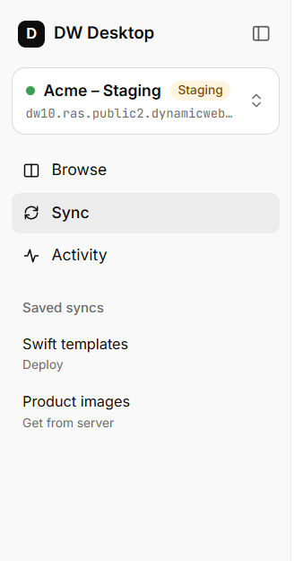

# DW Desktop 1.0 — Release notes

DW Desktop 1.0 turns the app from a manual file-transfer tool into a deployment tool. You can now **deploy** a local folder to a Dynamicweb 10 solution — and **get** what is missing on your computer — with a preview of every change before anything is written, protection against overwriting someone else's work, and a clear record of what happened.

The whole app has also been redesigned: a calmer layout, one place to switch environments, and clear marking of production sites.

---

## Highlights

- **Sync with preview** — deploy to the server or get from the server, and review every change first
- **Conflict protection** — files changed on the server since your last deploy are never silently overwritten
- **Environment types** — every environment is Production, Staging or Development; production gets a visible warning
- **Activity** — every transfer in one place, with cancel and retry, kept for 30 days
- **Saved syncs, pinned and recent folders** — get back to your usual work in one click
- **Faster and more reliable transfers** — built on the new Dynamicweb 10 File Transfer API

---

## Sync: deploy and get, with a preview

The new **Sync** view makes one folder match another. Pick a folder on your computer and a folder on the server — or click **Sync folder** in Browse to use the two folders you are looking at — and choose a direction:

- **Deploy to server** — upload what is new or changed on your computer.
- **Get from server** — download what is missing or different on your computer.

Click **Preview changes** and DW Desktop lists every file it would upload, download, replace or delete, and why. Untick anything you want to leave out, then run it. Nothing is transferred until you confirm.

Options:

- **Compare content, not just size and date** — compares file checksums for an exact result.
- **Delete files that aren't on the other side** — off by default. Files deleted on your computer go to the recycle bin / trash, so they can be restored.

## Conflict protection

DW Desktop remembers what each sync wrote. If a file has changed on the server since your last deploy — for example, a colleague fixed a template directly on the site — the preview marks it as a **conflict** instead of overwriting it. You decide per file: **Keep mine** or **Keep server's**.

The same protection applies at the moment a file is written: if the server file changed after you previewed, it is not overwritten, and you are asked to preview again.

## Environment types and production warning

Every environment now has a type — **Production**, **Staging** or **Development** — shown next to its name throughout the app. Deploying to a production environment shows a clear warning in the sync preview and in the upload dialog.

Switch environments from the top of the sidebar. Environments are grouped by type, and you can search when the list grows.

## Activity

**Activity** replaces the old transfer log. Every upload, download and sync is grouped into one entry, with progress while it runs and a summary when it is done.

- **Cancel** a whole transfer, or a single file while the rest carries on.
- **Retry failed** runs only the failed files again.
- Failures explain what went wrong in plain language.
- The history is kept for **30 days**. If DW Desktop is closed in the middle of a transfer, it shows as *Interrupted* the next time you open the app, ready to retry.

A small progress indicator in the bottom-right corner shows running transfers while you keep working in other views.

## Saved syncs, pinned and recent folders

- **Save this sync** keeps the folders, direction and options of a sync. Saved syncs appear in the sidebar — one click opens the preview again.
- **Pin** server folders you use often (from a folder's **···** menu).
- **Recent** lists the server folders you visited last.

All three are kept per environment.

## Browse improvements

- Labels above the two panes — **This computer** and the environment name — so it is always clear which side is which.
- **Compare** marks files as *Changed*, *Not on server* or *Only on server*, with one-click filters.
- **Filter this folder** filters both panes by name; click a column header to sort.
- **New folder**, **Move to folder…** and drag-to-move on the server.
- **Linked folders**: both panes navigate together when their folders match.

## Faster, more reliable transfers

DW Desktop 1.0 uses the new **Dynamicweb 10 File Transfer API** for everything:

- Large files are uploaded in chunks and verified with checksums.
- Several files transfer in parallel.
- Interrupted downloads continue where they stopped.
- Temporary network and server errors are retried automatically, without risk of applying a change twice.
- Folders of any size are listed in full — there is no longer a limit on the number of files shown.

---

## Before you upgrade

- **Your solution needs the File Transfer API.** DW Desktop 1.0 requires a Dynamicweb 10 version that includes the File Transfer API (`/Admin/Api/FileTransfer`). When you add or edit an environment, the connection test tells you if the solution doesn't support it — update the solution to use DW Desktop 1.0 with it.
- **Your environments and credentials carry over.** Existing environments open as *Development*. Edit each production and staging environment under **Settings** and set its type, so the production warning works.
- **Authentication is unchanged** — OAuth client credentials, API key, or username and password.

## Not in this release

- **Two-way sync** (both directions in one run) is planned. Today, run **Get from server** and **Deploy to server** separately.
- Per-file choices in the drag-and-drop upload dialog — use **Sync** when you need to decide file by file.

## Download

Get DW Desktop 1.0 from the [Releases page](https://github.com/dynamicweb/dw-desktop/releases/latest) — Windows (x64 and ARM64), macOS (Intel and Apple Silicon) and Linux. Existing installations update automatically.
